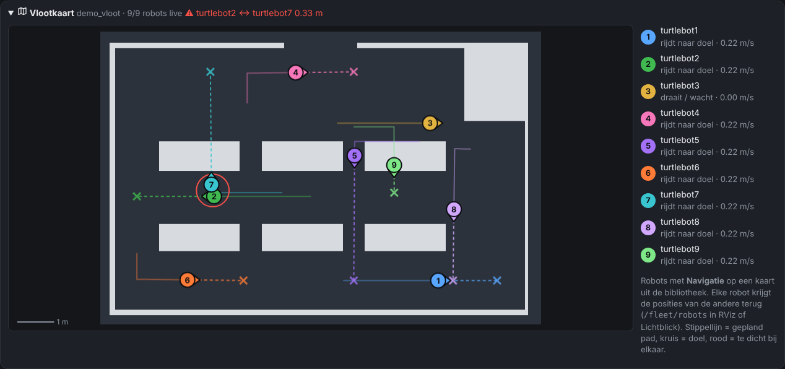

# Vloot: meerdere TurtleBots die van elkaar weten (concept)

Doel: meerdere robots rijden tegelijk in hetzelfde lokaal, kennen elkaars
positie, en de monitor toont ze live op één kaart. Showcase-waardig, en
didactisch: gedeeld coördinatenstelsel, lokalisatie, multi-robot.



## Idee in één zin

**Eén kaart voor iedereen** (kaartenbibliotheek) → elke robot lokaliseert zich
erop met Navigatie (AMCL) → elke robot stuurt zijn pose naar de **monitor** →
de monitor stuurt de andere robots terug.

```
            TB-AP-1 (NAT)          TB-AP-2 (NAT)          TB-AP-n
          ┌──────────────┐       ┌──────────────┐
          │ turtlebot1   │       │ turtlebot2   │   ...
          │ Nav2 + AMCL  │       │ Nav2 + AMCL  │
          │ fleet_node   │       │ fleet_node   │
          └──────┬───────┘       └──────┬───────┘
     POST /fleet │ 4 Hz  ▲ andere robots │
                 ▼       │               ▼
          ┌─────────────────────────────────────┐
          │ monitor (RPi aan de switch)         │
          │  kaartenbibliotheek  +  /fleet      │──▶ Vlootkaart op het scherm
          └─────────────────────────────────────┘
```

Waarom via de monitor en niet via Zenoh/DDS tussen de robots? Elke robot zit
achter de NAT van zijn eigen AP; de monitor is het enige punt dat ze allemaal
bereiken (zoals nu al met `/push` en `/poll`). HTTP, geen extra pakketten, en
het werkt met de huidige netwerkopbouw zonder wijziging. Verkeer: 9 robots ×
4/s × ~1,5 kB ≈ 50 kB/s, verwaarloosbaar.

Alternatief voor later: een `zenohd`-router op de monitor-RPi waar elke robot
als client naar verbindt. Dan zijn het echte ROS-topics (`/tbN/...`), maar
dat vraagt namespaces op alle robots en studentenlaptops zien dan alles.

## Fase 0 - monitor (deze branch)

- `POST /fleet` (robot): eigen pose in, andere robots op dezelfde kaart terug.
- `GET /api/fleet`: alle robots + paren die dichter dan 0,5 m bij elkaar zijn.
- **Vlootkaart** op de monitorpagina: de kaart uit de bibliotheek (PGM + YAML
  uit de bundel, in de browser gerenderd, ingezoomd op het gekende deel),
  robots als gekleurde bolletjes met neus en nummer, spoor van 40 s, gepland
  pad (stippellijn), doel (kruis), rood = te dicht, `?` = lokalisatie
  onzeker, grijs = > 3 s niets. Rijden robots op verschillende kaarten: keuzelijst.
- Testen zonder robots: `python3 tools/fake_fleet.py --robots 6` (zet kaart
  `demo_vloot` in de bibliotheek en laat robots rondjes rijden).

## Fase 1 - robot: `fleet_node` (concept in `robot/fleet_node.py`)

Hoort in `turtlebot_docker` (bin/, naast `system_info_node.py`), starten
samen met Navigatie (`launch_control_node`).

- Stuurt TF `map → base_footprint`, `/odom`-snelheid, `/plan` (doel + pad,
  max. 40 punten) en of AMCL zeker is (`/amcl_pose`-covariantie < 25 cm).
- Kaartnaam = `map_bundle.running_map()`: zonder Navigatie geen vloot (met
  SLAM heeft elke robot een eigen map-frame, posities zijn dan niet te vergelijken).
- Publiceert de andere robots: `/fleet/robots` (MarkerArray), `/fleet/poses`
  (PoseArray), `/fleet/obstacles` (PointCloud2).
- Niet getest op een robot (geen ROS hier); enkel de monitorkant is getest.

**Werkwijze in de klas / showcase**

1. Eén robot maakt met SLAM een kaart van het lokaal → *kaart naar bibliotheek*.
2. Bibliotheek → *naar robot... alle robots*.
3. Navigatie starten op alle robots met die kaart.
4. Beginpose: elke robot op een vast startvak zetten. Idee: zones
   `start_<nr>` in de kaartbundel, die `fleet_node` (of nav.html) als
   initialpose publiceert - geen 2D Pose Estimate per robot meer nodig.

## Fase 2 - elkaar ontwijken

Twee lagen, de eenvoudigste eerst:

1. **Voorrangsregel in `cmd_vel_guard`**: staat er een andere robot binnen
   0,5 m in de rijrichting, dan vooruit = 0 (draaien mag). Bij een frontale
   ontmoeting wacht het hoogste nummer. Robuust en makkelijk uit te leggen.
2. **Andere robots in de lokale costmap** zodat Nav2 er omheen plant, ook
   achter een hoek waar de lidar ze nog niet ziet:

   ```yaml
   local_costmap:
     local_costmap:
       ros__parameters:
         voxel_layer:            # TB3: voxel_layer in de lokale costmap
           observation_sources: scan fleet
           fleet:
             topic: /fleet/obstacles
             data_type: "PointCloud2"
             marking: True
             clearing: False
             max_obstacle_height: 0.3
             obstacle_max_range: 3.0
   ```

   Let op: een oude positie wordt enkel gewist door de raytrace van de lidar.
   In de lokale costmap gaat dat goed (de lidar ziet de vrijgekomen plek),
   in de globale costmap niet - daar dus niet toevoegen.

## Fase 3 - showcase

- **Missies vanuit de monitor**: klik op de vlootkaart = doel voor de
  geselecteerde robot (nieuw `/poll`-commando `nav_goal`, robot voert het uit
  met de Simple Commander). Of een route uit de kaartbundel per robot.
- **Taakverdeling**: "inspecteer deze 6 punten" → de monitor verdeelt over de
  vrije robots (dichtstbijzijnde eerst).
- **htmlsim**: meerdere robots in dezelfde browserwereld (één `fleet_node` per
  namespace) om alles eerst zonder hardware te tonen.
