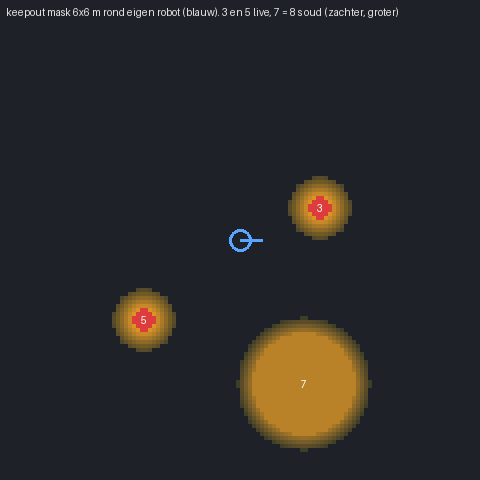

# Vloot: meerdere TurtleBots die van elkaar weten (concept)

Doel: meerdere robots rijden tegelijk in hetzelfde lokaal, kennen elkaars
positie, en de monitor toont ze live op één kaart. Showcase-waardig, en
didactisch: gedeeld coördinatenstelsel, lokalisatie, multi-robot.


## Idee in één zin

**Eén kaart voor iedereen** (kaartenbibliotheek) → elke robot lokaliseert zich
erop met Navigatie (AMCL) → elke robot stuurt zijn pose naar de **monitor** →
de monitor stuurt de andere robots terug.

```
            TB-AP-1 (NAT)          TB-AP-2 (NAT)          TB-AP-n
          ┌──────────────┐       ┌──────────────┐
          │ turtlebot1   │       │ turtlebot2   │   ...
          │ Nav2 + AMCL  │       │ Nav2 + AMCL  │
          │ fleet_node   │       │ fleet_node   │
          └──────┬───────┘       └──────┬───────┘
     POST /fleet │ 4 Hz  ▲ andere robots │
                 ▼       │               ▼
          ┌─────────────────────────────────────┐
          │ monitor (RPi aan de switch)         │
          │  kaartenbibliotheek  +  /fleet      │──▶ Vlootkaart op het scherm
          └─────────────────────────────────────┘
```

Waarom via de monitor en niet via Zenoh/DDS tussen de robots? Elke robot zit
achter de NAT van zijn eigen AP; de monitor is het enige punt dat ze allemaal
bereiken (zoals nu al met `/push` en `/poll`). HTTP, geen extra pakketten, en
het werkt met de huidige netwerkopbouw zonder wijziging. Verkeer: 9 robots ×
4/s × ~1,5 kB ≈ 50 kB/s, verwaarloosbaar.

Alternatief voor later: een `zenohd`-router op de monitor-RPi waar elke robot
als client naar verbindt. Dan zijn het echte ROS-topics (`/tbN/...`), maar
dat vraagt namespaces op alle robots en studentenlaptops zien dan alles.

## Fase 0 - monitor (deze branch)

- `POST /fleet` (robot): eigen pose in, andere robots op dezelfde kaart terug.
- `GET /api/fleet`: alle robots + paren die dichter dan 0,5 m bij elkaar zijn.
- **Vlootkaart** op de monitorpagina: de kaart uit de bibliotheek (PGM + YAML
  uit de bundel, in de browser gerenderd, ingezoomd op het gekende deel),
  robots als gekleurde bolletjes met neus en nummer, spoor van 40 s, gepland
  pad (stippellijn), doel (kruis), rood = te dicht, `?` = lokalisatie
  onzeker, grijs = > 3 s niets. Rijden robots op verschillende kaarten: keuzelijst.
- Testen zonder robots: `python3 tools/fake_fleet.py --robots 6` (zet kaart
  `demo_vloot` in de bibliotheek en laat robots rondjes rijden).

## Fase 1 - robot: `fleet_node` (concept in `robot/fleet_node.py`)

Hoort in `turtlebot_docker` (bin/, naast `system_info_node.py`), starten
samen met Navigatie (`launch_control_node`).

- Stuurt TF `map → base_footprint`, `/odom`-snelheid, `/plan` (doel + pad,
  max. 40 punten) en of AMCL zeker is (`/amcl_pose`-covariantie < 25 cm).
- Kaartnaam = `map_bundle.running_map()`: zonder Navigatie geen vloot (met
  SLAM heeft elke robot een eigen map-frame, posities zijn dan niet te vergelijken).
- Publiceert de andere robots: `/fleet/robots` (MarkerArray), `/fleet/poses`
  (PoseArray), `/fleet/keepout_mask` + `/fleet/filter_info` (costmap), service `/fleet/nearby`.
- Niet getest op een robot (geen ROS hier). Getest: de monitorkant en `fleet_core` (geheugen, nearby, mask).

**Werkwijze in de klas / showcase**

1. Eén robot maakt met SLAM een kaart van het lokaal → *kaart naar bibliotheek*.
2. Bibliotheek → *naar robot... alle robots*.
3. Navigatie starten op alle robots met die kaart.
4. Beginpose: elke robot op een vast startvak zetten. Idee: zones
   `start_<nr>` in de kaartbundel, die `fleet_node` (of nav.html) als
   initialpose publiceert - geen 2D Pose Estimate per robot meer nodig.

## Fase 2 - elkaar kennen en ontwijken (in `fleet_node` + `fleet_core`)

**Laatst gekende posities.** `fleet_node` onthoudt elke andere robot
(`FleetMemory`). Valt de monitor weg, dan blijft de laatste positie staan.
Na 3 s is ze *oud*: grijs in RViz, en de cirkel waar de robot kan zijn groeit
met v_max x (leeftijd - 3 s), tot max. 1 m extra. Na 15 s is hij vergeten.

**"Wie is er in de buurt?"** De robot vraagt het aan zichzelf: hij heeft het
beeld van de vloot lokaal, dus er gaat geen extra vraag naar de monitor.

```sh
ros2 service call /fleet/nearby std_srvs/srv/Trigger
# 2 robot(s) binnen 2.0 m: 4: 0.62 m links-voor; 7: 1.80 m achter (laatst gezien 6 s geleden)
```

Straal: parameter `nearby_radius` (2 m). In code: `/fleet/poses` (PoseArray).

**In de costmap: Nav2 KeepoutFilter met een bewegende mask.**
`fleet_node` publiceert 2x/s een `OccupancyGrid` van 6 x 6 m rond de robot
(`/fleet/keepout_mask`, map-frame) en de bijhorende `CostmapFilterInfo`
(`/fleet/filter_info`, type keepout). Elke andere robot = volle schijf
(waarde 100 -> lethal) met een aflopende rand van 25 cm; een oude positie
hoogstens 70 (vermijden, maar niet verboden) en groter.



```yaml
local_costmap:
  local_costmap:
    ros__parameters:
      filters: ["fleet_filter"]
      fleet_filter:
        plugin: "nav2_costmap_2d::KeepoutFilter"
        enabled: True
        filter_info_topic: "/fleet/filter_info"
        transform_tolerance: 0.2
global_costmap:
  global_costmap:
    ros__parameters:
      filters: ["fleet_filter"]
      fleet_filter:   # zelfde blok: dan plant de planner er ook omheen
        plugin: "nav2_costmap_2d::KeepoutFilter"
        enabled: True
        filter_info_topic: "/fleet/filter_info"
```

Waarom een filter en geen observation source in de obstacle/voxel layer:

| | obstacle/voxel layer (PointCloud2) | KeepoutFilter (mask) |
|---|---|---|
| oude posities | blijven staan tot de lidar ze wist; in de globale costmap nooit | elke mask volledig opnieuw getekend |
| oud = zachter | niet (alles is lethal) | ja, waarde per cel |
| inflatie | door de inflation layer | zit in de mask (de rand) - filters komen na de layers |
| extra code | geen | geen C++, enkel de mask |

Aandachtspunten (niet getest op een robot):
- De mask is in `map`, de lokale costmap in `odom`: de filter transformeert
  zelf (Jazzy: `transformPose` in `CostmapFilter`), dus TF map->odom moet er zijn.
- De KeepoutFilter logt een melding bij elke nieuwe mask; daarom 2 Hz en niet 4.
- Te dicht bij elkaar: staat de robot zelf al in de schijf van een andere,
  dan wordt die afgetopt op 70, anders "zit hij in een obstakel" en weigert
  de controller weg te rijden. Nieuwere Nav2-versies hebben daarvoor ook
  `override_lethal_cost` / `lethal_override_cost` in de filter.
- De eigen robot ziet de andere ook met de lidar (gewone obstacle layer); de
  mask voegt toe wat achter een hoek zit en waar hij naartoe rijdt.
- Mooiste vervolg: een eigen costmap-layer (C++, pluginlib) die ook het
  geplande pad van de andere robot als "zachte" kost tekent.

Eenvoudige extra veiligheidsregel (nog niet gebouwd): in `cmd_vel_guard`
vooruit = 0 als een andere robot < 0,5 m in de rijrichting staat; bij een
frontale ontmoeting wacht het hoogste nummer.

Test zonder ROS: `python3 robot/test_fleet_core.py`.

## Fase 3 - showcase

- **Missies vanuit de monitor**: klik op de vlootkaart = doel voor de
  geselecteerde robot (nieuw `/poll`-commando `nav_goal`, robot voert het uit
  met de Simple Commander). Of een route uit de kaartbundel per robot.
- **Taakverdeling**: "inspecteer deze 6 punten" → de monitor verdeelt over de
  vrije robots (dichtstbijzijnde eerst).
- **htmlsim**: meerdere robots in dezelfde browserwereld (één `fleet_node` per
  namespace) om alles eerst zonder hardware te tonen.
